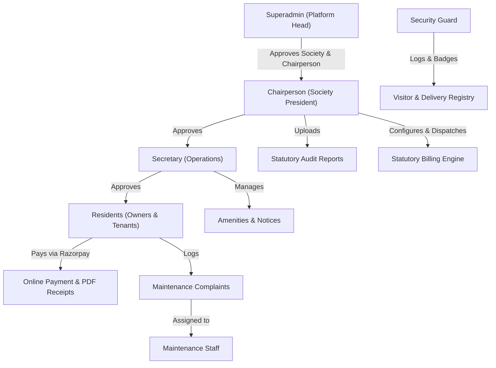

# 🏢 SocietyHub

> **Smart, Statutory-Compliant Co-operative Housing Society Management System**  
> A modern full-stack web application designed for residential societies, apartment complexes, and gated communities — fully aligned with statutory Housing Society Model Bye-Laws.

---

[](https://www.djangoproject.com/)
[](https://www.python.org/)
[](https://www.postgresql.org/)
[](https://razorpay.com/)
[](#-progressive-web-app-pwa--push-notifications)
[](LICENSE)

---

## 🌟 Overview

**SocietyHub** is an enterprise-grade Co-operative Housing Society (CHS) SaaS platform engineered to eliminate manual paperwork, non-transparent billing, and communication bottlenecks. Built with **Django**, **PostgreSQL**, **Razorpay**, and a responsive **Progressive Web App (PWA)** interface, SocietyHub unifies society executives, facility managers, security personnel, and residents under a single digital hub.

SocietyHub adheres to **Maharashtra Co-operative Societies (MCS) Model Bye-Law #67 standards**, providing itemized statutory maintenance invoices, arrears tracking, sinking fund calculations, CA audit repositories, and instant digital payment receipts.

---

## ✨ Key Features

### 1. 🏛️ Multi-Tier Role-Based Governance (RBAC)
- **Superadmin (Platform Owner):** Approves newly registered societies/buildings and validates designated Society Chairpersons.
- **Chairperson (Executive Head):** Configures recurring maintenance rates, dispatches society-wide bills, approves Secretaries, and publishes official financial audit reports.
- **Secretary (Administrative Officer):** Approves flat residents (Owners & Tenants), manages society amenities, publishes official circulars/notices, and oversees ticket resolution.
- **Resident (Flat Owner / Tenant):** Views and pays monthly maintenance via Razorpay, downloads statutory PDF receipts, books society amenities, logs complaints, and tracks visitors.
- **Maintenance Staff:** Receives categorized facility issues (plumbing, electrical, civil), updates progress status, and requests resident sign-off.
- **Security Guard (Gatekeeper):** Fast visitor check-in/out, logs delivery agents (Amazon, Zomato, Swiggy), and tracks guest access.



---

### 2. 💳 Statutory Maintenance Billing & Razorpay Integration
- **Bye-Law #67 Formula Engine:** Supports both per-sq.ft and fixed statutory heads:
  - Property Taxes & Sinking Fund (statutory % of construction cost/carpet area)
  - Repair & Maintenance Fund
  - Service & Common Charges
  - Electricity & Water Charges
  - Security Charges & Non-Occupancy Charges
  - Customizable Custom Heads
- **Recurring Automated Dispatch:** Monthly or Quarterly automated billing schedule trigger.
- **Razorpay Payment Gateway:** Secure online payments with signature verification and webhook callback handling.
- **Dynamic PDF Generation:**
  - Itemized Maintenance Invoices with breakdown particulars.
  - Official Tax & CHS Receipts with unique sequential serial numbers (`SH-REC-YYYY-XXXX`).
  - Arrears & Advance balance adjustment tracking.

---

### 3. 🛡️ Gate & Visitor Management
- Digital Gatekeeper console for security cabins.
- Real-time logging of deliveries, cab pickups, couriers, and personal guests.
- Live badge statuses (`Checked In` vs `Checked Out`) with timestamped entry and exit.

---

### 4. 🛠️ Complaint Helpdesk & Service Ticketing
- Categorized ticketing: `Electrical`, `Plumbing`, `Security`, `Maintenance`, `General`.
- Complete ticket lifecycle: `Pending` ➔ `In Progress` ➔ `Completed` ➔ `Resident Closed / Reopened`.
- Audit history with staff assignment and rejection remarks.

---

### 5. 🏊 Amenity Booking & Collision Prevention
- Schedule clubhouses, banquet halls, swimming pools, tennis courts, and gym slots.
- Automatic slot collision prevention ensuring zero double-bookings.
- Configurable booking fees and resident cancellation handling.

---

### 6. 📑 Statutory Financial Audit Repository
- Dedicated digital vault for Chartered Accountant (CA) verified annual audit reports.
- Transparent access for all approved society members to inspect audited balance sheets and financial statements.

---

### 7. 📲 Progressive Web App (PWA) & Push Notifications
- **PWA Ready:** Installable on Android, iOS, Windows, and macOS via `manifest.json` and service worker caching (`sw.js`).
- **Web Push Notifications (VAPID):** Instant browser and mobile push alerts for maintenance invoices, emergency circulars, and ticket progress using `pywebpush`.
- **In-App Notification Center:** Real-time polling API with unread counter badges and instant mark-as-read functionality.

---

## 🏗️ Project Architecture

```
SocietyHub_project/
├── manage.py                     # Django management script
├── requirements.txt              # Production & dev dependencies
├── .env.example                  # Environment variable blueprint
├── README.md                     # Project documentation
├── media/                        # User uploads (Audit PDFs, attachments)
└── SocietyHub/                   # Core Django project package
    ├── asgi.py & wsgi.py         # Application entry points
    ├── settings.py               # Django configuration & environment setup
    ├── urls.py                   # Master routing table
    ├── billing/                  # Billing, Razorpay, Bye-law calculation & PDF receipts
    │   ├── models.py             # PaymentTransaction, MaintenanceScheduleConfig, AuditReport
    │   ├── views.py              # Razorpay checkout, PDF generation, bulk actions
    │   └── urls.py
    ├── bookings/                 # Amenity booking & slot management
    │   ├── models.py             # Amenity, AmenityBooking
    │   ├── views.py & forms.py
    │   └── tests.py              # Automated test suite
    ├── complaints/               # Helpdesk ticketing & resolution workflows
    │   ├── models.py             # Complaint model with status workflows
    │   └── views.py
    ├── visitors/                 # Security gatekeeper visitor register
    │   ├── models.py             # Visitor entry/exit records
    │   └── views.py
    ├── notices/                  # Society circulars and announcements
    ├── users/                    # Multi-role authentication & approval hierarchy
    │   ├── models.py             # Society, UserProfile, Notice
    │   └── views.py              # Registration, profile edit, multi-tier approvals
    ├── core/                     # Common dashboard, PWA endpoints & Web Push
    │   ├── models.py             # PushSubscription, Notification
    │   ├── views.py              # Push VAPID APIs, in-app notification polling
    │   └── urls.py
    ├── static/                   # CSS, JavaScript, Icons, PWA manifests
    └── templates/                # Responsive HTML5 & Tailwind UI templates
        ├── auth/                 # Login, registration, password reset
        ├── billing/              # Bills, payment modals, receipts, audit reports
        ├── bookings/             # Amenity catalogs & booking schedules
        ├── complaints/           # Ticket creation and resolution cards
        ├── visitors/             # Gatekeeper terminal
        └── base.html             # Base layout with PWA shell & notification drawer
```

---

## 💻 Tech Stack

| Domain | Technology |
|---|---|
| **Backend Framework** | [Django 4.2+ (Python 3.10+)](https://www.djangoproject.com/) |
| **Database** | [PostgreSQL](https://www.postgresql.org/) (Production-ready with SSL support) / SQLite (Local Dev) |
| **Payment Gateway** | [Razorpay Python SDK](https://razorpay.com/) |
| **Push Notifications** | Web Push Protocol (VAPID) via [pywebpush](https://github.com/web-push-libs/pywebpush) |
| **Frontend & UI** | Semantic HTML5, Vanilla JavaScript, Tailwind CSS utility system |
| **PWA Layer** | Service Workers (`sw.js`), Web App Manifest (`manifest.json`), Offline Fallback |
| **Document Engine** | Dynamic HTML printable views / PDF generation for receipts and bills |

---

## 🚀 Quickstart & Installation

### 1. Prerequisites
Ensure you have the following installed on your machine:
- **Python 3.10+**
- **Git**
- **PostgreSQL** (or SQLite for quick local experimentation)

---

### 2. Clone the Repository
```bash
git clone https://github.com/technerdsreenath/SocietyHub.git
cd SocietyHub_project
```

---

### 3. Create and Activate a Virtual Environment
- **On Linux / macOS:**
  ```bash
  python3 -m venv venv
  source venv/bin/activate
  ```
- **On Windows (PowerShell):**
  ```powershell
  python -m venv venv
  .\venv\Scripts\Activate.ps1
  ```

---

### 4. Install Dependencies
```bash
pip install -r requirements.txt
```

---

### 5. Environment Configuration
Create a `.env` file in the project root directory (next to `manage.py`). You can copy the template below:

```ini
# Django Core Settings
SECRET_KEY=your-django-super-secret-key-change-in-production
DEBUG=True
ALLOWED_HOSTS=127.0.0.1,localhost

# Database Configuration (PostgreSQL)
DB_NAME=societyhub_db
DB_USER=postgres
DB_PASSWORD=your_postgres_password
DB_HOST=localhost
DB_PORT=5432

# Email Configuration (SMTP for Password Resets & Notifications)
EMAIL_BACKEND=django.core.mail.backends.smtp.EmailBackend
EMAIL_HOST=smtp.gmail.com
EMAIL_PORT=587
EMAIL_USE_TLS=True
EMAIL_HOST_USER=your_email@gmail.com
EMAIL_HOST_PASSWORD=your_email_app_password
DEFAULT_FROM_EMAIL=your_email@gmail.com

# Razorpay Payment Gateway Credentials
RAZORPAY_KEY_ID=rzp_test_your_key_id
RAZORPAY_KEY_SECRET=your_razorpay_secret_key

# Web Push Notification Settings (VAPID)
VAPID_PUBLIC_KEY=BGWWKBL3Rb6kQdcf0Jn8Rj8q101njH20EFyPwkcNAlgkGgvDyEElt98O7PHfEFss1MrZab3z4RvFOHZIJDejsuI
VAPID_PRIVATE_KEY=xPIuHpz5_im3A_I_P0sWQ0yob44GVg86m0xSHmDWAEU
VAPID_CLAIM_EMAIL=mailto:admin@societyhub.local
```

> 💡 **Tip:** Generate a new Django `SECRET_KEY` anytime using:
> ```bash
> python -c "from django.core.management.utils import get_random_secret_key; print(get_random_secret_key())"
> ```

---

### 6. Apply Database Migrations
```bash
python manage.py migrate
```

---

### 7. Create Superuser (Admin)
```bash
python manage.py createsuperuser
```
Follow the interactive prompts to set an admin username, email, and password.

---

### 8. Run the Development Server
```bash
python manage.py runserver
```
Visit **`http://127.0.0.1:8000/`** in your browser.

---

## 🧪 Running Automated Tests

Run the test suite using Django's built-in test runner:

```bash
# Run all project tests
python manage.py test

# Run tests for specific modules (e.g., bookings)
python manage.py test SocietyHub.bookings
```

---

## 👥 User Roles & Workflow

| Role | Initial Step | Primary Capabilities |
|---|---|---|
| **Superadmin** | Created via CLI (`createsuperuser`) | Approves newly created Societies and Chairperson accounts at `/superadmin/approvals/`. |
| **Chairperson** | Registers with role `Chairperson` | Awaits Superadmin approval; sets maintenance charges, dispatches recurring bills, approves Secretaries, and uploads annual audit reports. |
| **Secretary** | Registers with role `Secretary` | Awaits Chairperson approval; approves resident registrations, adds society amenities, creates notices, and manages complaints. |
| **Resident** | Registers with flat wing, number, and type (`Owner` / `Tenant`) | Awaits Secretary approval; pays maintenance via Razorpay, downloads receipts/bills, raises service tickets, and books amenities. |
| **Security Guard** | Registers with role `Security Guard` | Manages front gate visitors, delivery agents, cabs, and real-time check-in/out badges. |
| **Maintenance Staff** | Registers with role `Maintenance Staff` | Views assigned repair tickets (Electrical, Plumbing, etc.) and marks resolutions for resident sign-off. |

---

## 🔌 API & Integration Endpoints

| Category | Endpoint | Method | Description |
|---|---|---|---|
| **PWA** | `/manifest.json` | `GET` | Web App Manifest configuration |
| **PWA** | `/sw.js` | `GET` | Service worker for offline caching & background push |
| **PWA** | `/offline/` | `GET` | Friendly fallback view when device is disconnected |
| **Web Push** | `/api/push/vapid-key/` | `GET` | Returns VAPID public key for browser registration |
| **Web Push** | `/api/push/subscribe/` | `POST` | Registers browser push subscription credentials |
| **Web Push** | `/api/push/unsubscribe/` | `POST` | De-registers browser push subscription |
| **Web Push** | `/api/push/test/` | `POST` | Sends an instant test push notification |
| **In-App Alerts**| `/api/notifications/poll/` | `GET` | Real-time polling API for unread notification count |
| **In-App Alerts**| `/api/notifications/` | `GET` | Returns list of recent in-app notifications |
| **In-App Alerts**| `/api/notifications/<id>/mark-read/` | `POST` | Marks individual notification as read |
| **In-App Alerts**| `/api/notifications/mark-all-read/` | `POST` | Marks all notifications as read |
| **Payments** | `/billing/pay/<id>/` | `GET/POST`| Initiates Razorpay payment order for bill |
| **Payments** | `/billing/callback/` | `POST` | Razorpay signature verification & receipt generation |

---

## 📄 License

This project is licensed under the **MIT License** — feel free to use, modify, and distribute it for personal and commercial housing society deployments.

---

## 🤝 Contributing

Contributions, feedback, and feature suggestions are welcome!

1. Fork the Project
2. Create your Feature Branch (`git checkout -b feature/AmazingFeature`)
3. Commit your Changes (`git commit -m 'Add some AmazingFeature'`)
4. Push to the Branch (`git push origin feature/AmazingFeature`)
5. Open a Pull Request

---

<p align="center">
  Built with ❤️ by Sreenath Nair for hassle-free housing society governance.
</p>
